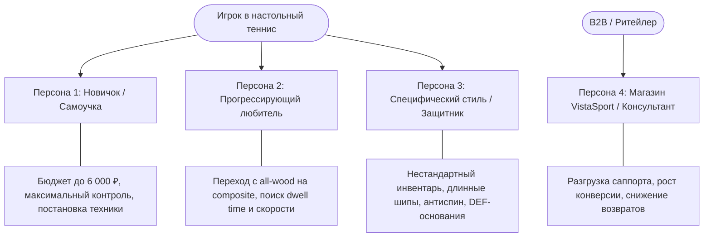
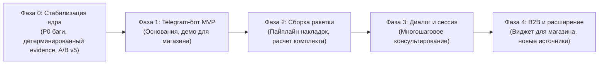

# Продуктовое видение: VistaSport RAG (AI-консультант по инвентарю)

> **Версия:** 1.1 (7 ноября 2026)
>
> **Роль:** Product Owner
>
> **Статус:** Согласовано с техническим лидом (Codex), принято в работу
>
> **Связанные документы:** [docs/PRODUCT_BRIEF.md](PRODUCT_BRIEF.md), [docs/CURRENT_STATE.md](CURRENT_STATE.md), [docs/SPRINT_1_BACKLOG.md](SPRINT_1_BACKLOG.md)

---

## 1. Резюме и Миссия Продукта (Executive Summary & Mission)

### Миссия
> **Создать объективного, проверяемого и полезного AI-консультанта по инвентарю для настольного тенниса, рекомендации которого подтверждаются каталогом и реальным опытом игроков — без скрытого маркетинга, выдуманных характеристик и искажения фактов.**

### Проблема рынка (Problem Statement)
Подбор ракетки для настольного тенниса — одна из самых сложных и непрозрачных задач в любительском спорте:
1. **«Паралич выбора» и сложность спецификаций:** сотни оснований, десятки пород дерева (Limba, Koto, Hinoki), разные типы композитов (ALC, ZLC, CNF), расположение слоёв (Outer vs Innerforce), вес, баланс, типы ручек (FL, ST, AN).
2. **Несопоставимость шкал производителей:** у Butterfly скорость 11.8, у Donic 9+, у Stiga 140, у Yasaka 20. Их невозможно линейно сопоставить в единую шкалу. Попытка магазинов или простых LLM сделать это приводит к дезинформации.
3. **Субъективность и шум комьюнити:** на форумах новичкам часто советуют слишком быстрый профессиональный инвентарь (например, *Viscaria*), на котором невозможно поставить правильную базовую технику.
4. **Конфликт интересов в ритейле:** живые консультанты или алгоритмы интернет-магазинов нередко мотивированы продавать залежавшийся или маржинальный товар, а не то, что нужно конкретному игроку.

### Наше решение (Value Proposition)
**VistaSport RAG** — это интеллектуальный ассистент, который:
- Подбирает инвентарь **строго под уровень, стиль игры и бюджет** пользователя.
- Опирается на **проверяемые данные каталога** (наличие, актуальная цена, паспортные характеристики слоёв).
- Обогащает рекомендации **верифицированными сигналами опыта сообщества** (пилот BladeRubber.net; в перспективе — другие публичные источники при наличии технической возможности) в формате прозрачной статистики («*2 из 5 просмотренных отзывов отметили мягкое чувство мяча*»).
- **Стремится к нулевому уровню галлюцинаций:** если по запросу нет подходящих вариантов в бюджете или данных недостаточно, ассистент прямо сообщает об этом либо задаёт фокусирующий уточняющий вопрос.

---

## 2. Целевая аудитория и Персоны (Target Audience & Personas)

### Персона 1: Новичок («Алексей, 28 лет»)
- **Контекст:** Играет в офисе или спортклубе пару раз в неделю. Хочет собрать первую сборную ракетку вместо готовой магазинной.
- **Боль:** Бюджет ограничен (до 5 000 – 7 000 ₽). Тонет в терминах: «Что такое ALL+, OFF-, карбон, лимба?». Боится купить дорогую пушку, которой не сможет попасть на стол.
- **Ожидание от продукта:** Простое объяснение, строгое соблюдение бюджета, рекомендация контрольного деревянного основания (ALL / ALL+) с понятным обоснованием.

### Персона 2: Прогрессирующий любитель («Дмитрий, 35 лет»)
- **Контекст:** Тренируется с тренером, играет турниры уровня 250–450 RTTF. Хочет перейти с деревянного основания на композит, чтобы добавить мощи в атаке.
- **Боль:** Маркетинг обещает «мощь и контроль». Дмитрий боится «стеклянного» жесткого чувства и потери контроля на приёме. Ищет мягкий композит (Innerforce-структуру).
- **Ожидание от продукта:** Разделение маркетинговых заявлений и реального чувства мяча (dwell-time), опора на отзывы реальных игроков.

### Персона 3: Игрок специфического стиля («Сергей, 50 лет»)
- **Контекст:** Ветеран, играет в защите или блоке с длинными шипами (OX) на backhand.
- **Боль:** Большинство современных оснований слишком быстрые или дают плохой реверс вращения с шипами.
- **Ожидание от продукта:** Чёткое разграничение: есть ли в просмотренных отзывах подтверждённый опыт игры с длинными шипами, либо честное предупреждение о нехватке данных.

### Персона 4 (B2B): Интернет-магазин / Продавец-консультант
- **Боль:** Типовые запросы в чатах магазина: «Посоветуйте ракетку новичку за 5 тысяч». Консультант тратит время на первичный сбор требований.
- **Ожидание:** Автоматизированный подбор с прямыми ссылками на карточки товаров магазина, повышающий конверсию из поиска в покупку.

---

## 3. Ключевые принципы продукта (Product Principles)

1. **Честность превыше продажи (Grounded Truth Over Selling)**
   - Продукт не придумывает характеристики, совместимость или несуществующие свойства.
   - Если по запросу пользователя в рамках бюджета подходящих вариантов в выборке нет — сервис прямо сообщает об этом, а не предлагает товары дороже.
2. **Факты каталога vs Сигналы отзывов (Strict Evidence Separation)**
   - Паспортные данные (слои, порода дерева, класс ALL/OFF, цена, наличие) — это факты каталога.
   - Отзывы сообщества — это статистический сигнал по просмотренной выборке. Они формулируются нейтрально («*В 1 из 3 просмотренных отзывов отмечен негативный опыт с длинными шипами*»), без категоричных обещаний («гарантированно подойдёт»).
3. **Запрет межбрендовых шкал (No Cross-Brand Fallacy)**
   - Запрещено выстраивать единый числовой рейтинг скорости/контроля между товарами разных брендов.
4. **Детерминированные ограничения (Code Controls Constraints)**
   - Фильтрация по бюджету, проверка наличия, валидация ссылок и сборка числовых фактов доказательств производятся **детерминированным кодом**. Модель отвечает за синтез естественного языка и формулирование рекомендаций на основе переданных данных.
5. **Культура прозрачного уточнения (Clarification over Guessing)**
   - На общий запрос («*Посоветуй хорошее основание*») ассистент задаёт один фокусирующий вопрос (уровень, стиль, бюджет) без преждевременных рекомендаций.

---

## 4. Дорожная карта продукта (Roadmap)

### Фаза 0: Стабилизация ядра (Текущий этап)
- Исправление бюджетного фильтра: честное сообщение при отсутствии подходящих вариантов в бюджете.
- Детерминированная сборка блока evidence кодом; разгрузка модели от форматирования числовых фраз.
- Логирование причин отклонений валидатора для прозрачной диагностики.
- Полный прогон протокола v5 и строгий ручной аудит.

### Фаза 1: Telegram-бот MVP (Основания)
- Запуск Telegram-бота на `aiogram` 3.x с интеграцией текущего стабильного пайплайна подбора оснований.
- Инлайн-кнопки со ссылками на карточки товаров VistaSport.
- Кнопки обратной связи (👍 / 👎) для сбора первых продуктовых метрик.
- Демо-образец для презентации менеджменту VistaSport.

### Фаза 2: Сборка ракетки (Основание + Накладки)
- Скрейпинг каталога накладок VistaSport (гладкие, шипы, антиспин), расширение схемы БД.
- Логика распределения общего бюджета ракетки (основание + 2 накладки) и базовые правила совместимости по стилю игры.

### Фаза 3: Диалоговая сессия и контекст
- Поддержка памяти диалога: сохранение критериев после уточняющего вопроса.
- Ответы на сравнительные вопросы («*Чем первое основание отличается от второго?*»).

### Фаза 4: B2B и масштабирование
- Веб-виджет для интеграции в интернет-магазин.
- Подключение дополнительных источников отзывов (при наличии публичного API или разрешения).

---

## 5. Метрики успеха (Success Metrics)

1. **Метрики качества RAG (Quality & Grounding KPIs):**
   - **Соблюдение бюджета:** 0 нарушений заявленного верхнего порога цены.
   - **Точность evidence:** 0 ошибок в числах «N из M» и привязке к товарам/сигналам.
   - **Отсутствие кросс-брендовых шкал:** 0 некорректных сравнений разных шкал производителей.
   - **Порог качества эксперимента:** не менее **12 из 15 (80%)** успешных ответов в enriched-условии по строгому ручному аудиту.
2. **Метрики пользовательского опыта (Product KPIs):**
   - **Доля полезных консультаций (CSAT):** > 80% положительных оценок в Telegram-боте.
   - **CTR в каталог:** > 30% переходов по ссылкам на товары магазина.
   - **Производительность:** целевое время ответа P95 < 3.5–5 секунд (требует подтверждения замерами).
