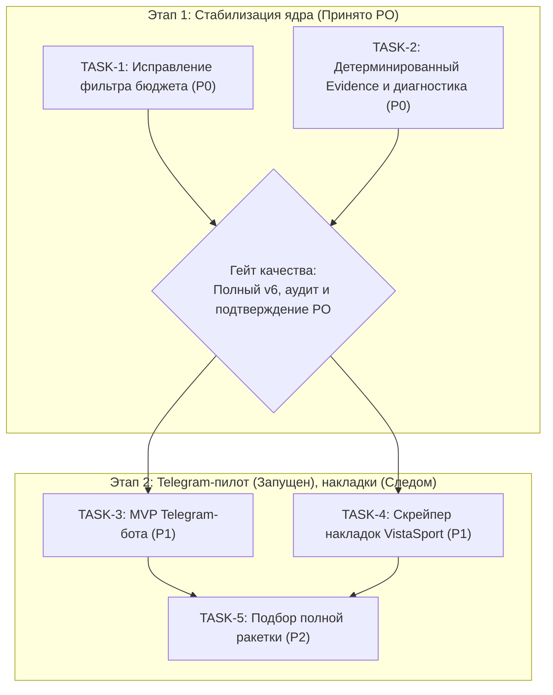

# Бэклог Спринта 1: Стабилизация ядра и запуск Telegram-бота

> **Роль:** Product Owner
>
> **Статус:** Согласовано с техническим лидом (Codex)
>
> **Связанные документы:** [docs/PRODUCT_VISION.md](PRODUCT_VISION.md), [docs/PRODUCT_BRIEF.md](PRODUCT_BRIEF.md), [docs/CURRENT_STATE.md](CURRENT_STATE.md)

---

## 1. Стратегия спринта и фазирование

Спринт разделен на два четких этапа с жестким гейтом качества между ними:
1. **Этап 1 (Фаза 0: Стабилизация ядра, P0) — Принят PO, гейт v6 подтверждён:**
   Устранение бага утечки бюджета, переход к детерминированной сборке evidence в коде, логирование отклонений валидатора и проведение чистого A/B-эксперимента v5 со строгим аудитом.
2. **Этап 2 (Фаза 1: Пользовательский интерфейс и накладки, P1) — Telegram-пилот запущен:**
   Запуск Telegram-бота для демонстрации магазина и игрокам, последующее подключение скрейпинга накладок.

---

## 2. Детализация задач

### TASK-1 (P0): Исправление обработки бюджета в RAG

**Статус реализации 7 ноября:** исправлено в CLI и eval-runner; краевые и
интеграционные unit-тесты проходят, генерация при пустом бюджетном результате
не вызывается.

- **Проблема:**
  В [`src/vsitemssrag/cli/rag.py`](../src/vsitemssrag/cli/rag.py), если пользователь задал верхний бюджет (`max_price`), но в поисковой выборке нет товаров дешевле этой суммы, код возвращает исходную выборку кандидатов выше бюджета. Модель рекомендует их, нарушая жесткое ограничение.
- **Требования к реализации:**
  1. **Формирование ответа в коде без LLM:** Если `max_price is not None` и список подходящих товаров в рамках бюджета пуст (`not within_budget`), не вызывать Gemini.
  2. **Корректная формулировка:** Выдавать точное сообщение:
     *«По вашему запросу не найдены варианты до {max_price} ₽. Попробуйте изменить критерии поиска или увеличить бюджет.»*
     *(Не утверждать об отсутствии товаров во всем каталоге без отдельного запроса в БД; не давать советов о готовых ракетках, которых нет в подборе).*
  3. **Синхронизация CLI и Eval-Runner:** Логика должна быть единообразной как в CLI (`run_ask`), так и в runner тестов (`evals/run_enrichment_ab.py`), чтобы runner корректно фиксировал исход без падения.
  4. **Граничные unit-тесты в [`tests/unit/test_rag.py`](../tests/unit/test_rag.py):**
     - Все кандидаты дороже бюджета.
     - Цена товара отсутствует / неизвестна (`None`).
     - Цена товара ровно на границе бюджета (`price == max_price`).
     - Смешанная выборка (часть дешевле, часть дороже).
- **Критерии приёмки (DoD):**
  - Ни при каких условиях пользователю не выдаются рекомендации товаров с ценой выше `max_price`.
  - Все тесты `tests/unit/` проходят успешно.

---

### TASK-2 (P0): Детерминированный вывод Evidence, диагностика и разблокировка v5

**Статус реализации 7 ноября:** сборка числового блока и лог отклонений
реализованы, unit-тесты проходят, протокол v5 создан. Статус эксперимента
и гейта качества фиксируется отдельно в CURRENT_STATE.md. Полный v5 дал
11/15 enriched по аудиту агента — гейт не пройден. После разбора причин
выполнен отдельный v6: 30/30 ответов, 13/15 enriched по аудиту агента,
88 evidence-фраз без ошибок. Экспериментальный гейт пройден; сравнительные
формулировки ещё требуют доработки. Отчёты — AB_V5_AUDIT.md и AB_V6_AUDIT.md.

- **Проблема:**
  В эксперименте v4 модель споткнулась о валидатор при попытке самостоятельно воспроизвести числовые формулировки статистики отзывов («2 из 5 отзывов»). Отклонённый текст не был сохранён локально, что затрудняет диагностику.
- **Требования к реализации:**
  1. **Детерминированная сборка блока статистики кодом:**
     - Снять с модели обязанность самостоятельно формулировать и форматировать числовые фразы вида «N из M».
     - Формировать блок статистики («*Отзывы сообщества: В N из M просмотренных отзывов...*») детерминированным кодом в [`src/vsitemssrag/rag/context.py`](../src/vsitemssrag/rag/context.py) / [`src/vsitemssrag/rag/advisor.py`](../src/vsitemssrag/rag/advisor.py).
     - Прикреплять доказательства **только** к отобранным товарам, с сохранением ссылок на источники.
  2. **Запрет на выдумывание статистики моделью:**
     - В системной инструкции явно запретить модели приводить собственные непроверенные цифры и проценты отзывов.
     - Валидатор проверяет итоговый ответ целиком: блок доказательств не должен соседствовать с неподтверждёнными выводами («гарантированно подойдёт для шипов»).
  3. **Диагностика отклонений валидатора:**
     - Сохранять отклонённый ответ модели и точную причину ошибки в локальный файл отладки/лога для упрощения разбора.
  4. **Подготовка протокола v5 и аудит:**
     - Создать `evals/enrichment_ab_protocol_v5.json` с отдельным выходным файлом.
     - Разделить критерий: завершение кода != завершение эксперимента. Эксперимент считается завершенным только после полного прогона (30 ответов) и строгого ручного аудита (порог: >= 12/15 enriched и 0 ошибок чисел).
- **Критерии приёмки (DoD):**
  - Тестовые сценарии (включая `fast_attack_carbon`) с `--evidence-file` проходят валидацию.
  - Причины отклонений сохраняются в диагностический лог.
  - Протокол v5 готов к чистому A/B-прогону.

---

### TASK-3 (P1): MVP Telegram-бота для консультаций

**Статус реализации 7 ноября:** реализован и запущен локально
[@vistasportassistant_bot](https://t.me/vistasportassistant_bot). Общий RAG-сервис,
инлайн-кнопки и SQLite-feedback работают; реальный ответ доставлен и оценка
сохранена. 100 unit-тестов и сборка проходят. Инструкция —
[TELEGRAM_BOT.md](TELEGRAM_BOT.md). Многошаговый диалог не добавлялся.

- **Цель:** Получить работающий пользовательский интерфейс для реальных игроков и демонстрации магазину VistaSport.
- **Стек:** `aiogram` 3.x.
- **Требования:**
  1. Добавить зависимость `aiogram` через `uv add aiogram`.
  2. Создать модуль `src/vsitemssrag/bot/` и CLI-команду `uv run vsitemssrag bot run`.
  3. Обработка команд:
     - `/start` — приветствие и правила формулирования запроса.
     - Текстовый запрос — обращение к RAG-пайплайну.
  4. Вывод: форматированный ответ + инлайн-кнопки со ссылками на карточки товаров в магазине VistaSport.
  5. Кнопки оценки под ответом: 👍 / 👎 с логированием фидбека.
- **Критерии приёмки:**
  - Бот стабильно отвечает на запросы в Telegram, корректно обрабатывая тайм-ауты и ошибки форматирования.

---

### TASK-3.1 (P1): Устранение багов отображения и улучшение вёрстки в Telegram-боте

**Статус реализации 7 ноября:** реализовано. Карточки и кнопки нумеруются
по первому появлению товара в ответе; технические цитаты убраны из Telegram,
цены форматируются кодом, оговорки о шкалах перенесены в подвал. Статистика
отзывов и источники сохраняются у соответствующих карточек. 112 unit-тестов
проходят; все 30 сохранённых ответов v6 проверены новым адаптером без API-вызовов.
Это проверка отображения, а не новый A/B-гейт или пользовательская приёмка.

- **Контекст:**
  По результатам первого тестирования бота выявлен критический баг рассинхрона кнопок и неряшливая вёрстка (спам цитатами `[2]`, плохой формат цен `6960.00 RUB`, громоздкие дисклеймеры в начале ответа).
- **Проблемы и требования к реализации:**
  1. **Критический UX-фикс: Порядок ссылок и кнопок (Order of Appearance):**
     - В [`src/vsitemssrag/rag/validation.py`](../src/vsitemssrag/rag/validation.py) и [`src/vsitemssrag/rag/service.py`](../src/vsitemssrag/rag/service.py) функция извлечения ссылок `answer_citations` использует `sorted(...)`. Если модель в тексте сначала рекомендует товар `[2]`, а затем `[1]`, кнопки выводятся в порядке `[1]`, затем `[2]`. Пользователь жмет на первую кнопку и открывает чужой товар!
     - **Решение:** Ссылки для кнопок должны сохранять **порядок первого появления в тексте ответа** (order of first appearance).
     - Номера на кнопках должны строго соответствовать пунктам в сообщении: пункт 1 в тексте = первая кнопка.
  2. **Очистка текста от спама цитатами `[N]` (Presentation Cleanup):**
     - Модель ставит цитаты по несколько раз в предложении: *«DONIC Original Dotec ALL [2] — основание без композита [2] типа ALL [2] с ценой 6960.00 RUB.»*
     - В модуле адаптера [`src/vsitemssrag/bot/presentation.py`](../src/vsitemssrag/bot/presentation.py) при подготовке текста для Telegram очищать избыточные технические маркеры `[N]` из середины предложений или заменять их на аккуратную нумерацию, так как ссылки уже вынесены в инлайн-кнопки.
  3. **Форматирование цен и карточек (Visual Hierarchy):**
     - Привести цены к стандарту: `6 960 ₽` вместо `6960.00 RUB` и `2755.00 руб.` (без копеек, с пробелом разряда тысяч и знаком ₽).
     - Использовать понятную структуру карточки товара с буллетами:
       `1️⃣ Название — Цена`
       `• Тип и слои: ...`
       `• Особенности: ...`
  4. **Позиционирование оговорок о шкалах (Caveat Placement):**
     - Предупреждение о несовместимости шкал производителей перенести в компактный подвал сообщения (сноску), чтобы рекомендации товаров шли сразу после вводного предложения.
  5. **Тесты:**
     - Добавить unit-тесты в `tests/unit/test_bot.py` на сохранение порядка появления товаров на кнопках (order of appearance) и на формат цен.
- **Критерии приёмки (DoD):**
  - Пункт 1 в сообщении Telegram ВСЕГДА соответствует первой кнопке со ссылкой на правильный товар.
  - В тексте отсутствуют повторяющиеся токены вида `[2] ... [2]`.
  - Цены оформлены в человекочитаемом виде (`X XXX ₽`).
  - Все тесты проходят успешно.

---

### TASK-4 (P1): Скрейпинг каталога накладок VistaSport

- **Цель:** Подготовить данные для подбора ракеток в сборе (основание + накладки).
- **Требования:**
  1. В [`src/vsitemssrag/models.py`](../src/vsitemssrag/models.py): добавить поддержку категории товара (`blade`, `rubber`) и атрибутов накладки (тип резины: гладкая, короткие шипы, длинные шипы, антиспин; толщина губки; жесткость).
  2. Миграция базы данных `003_add_rubbers.sql` в [`src/vsitemssrag/storage/migrations/`](../src/vsitemssrag/storage/migrations/).
  3. Модуль парсинга накладок в [`src/vsitemssrag/scraping/vistasport.py`](../src/vsitemssrag/scraping/vistasport.py) с командой `uv run vsitemssrag scrape-rubbers`.
- **Критерии приёмки:**
  - Пробный запуск парсит и сохраняет 10 накладок с корректными вариантами толщин и цен.

---

### TASK-5 (P2): Логика комплексного подбора ракетки (Комплект)

- **Цель:** Алгоритм распределения бюджета и подбора совместимого комплекта (Основание + FH-накладка + BH-накладка).
- **Критерии приёмки:**
  - Сумма компонентов укладывается в бюджет; рекомендации учитывают уровень игрока и толщину губки.
